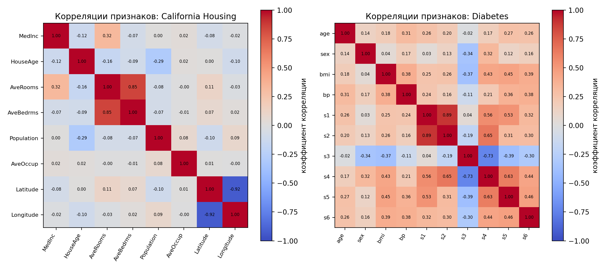
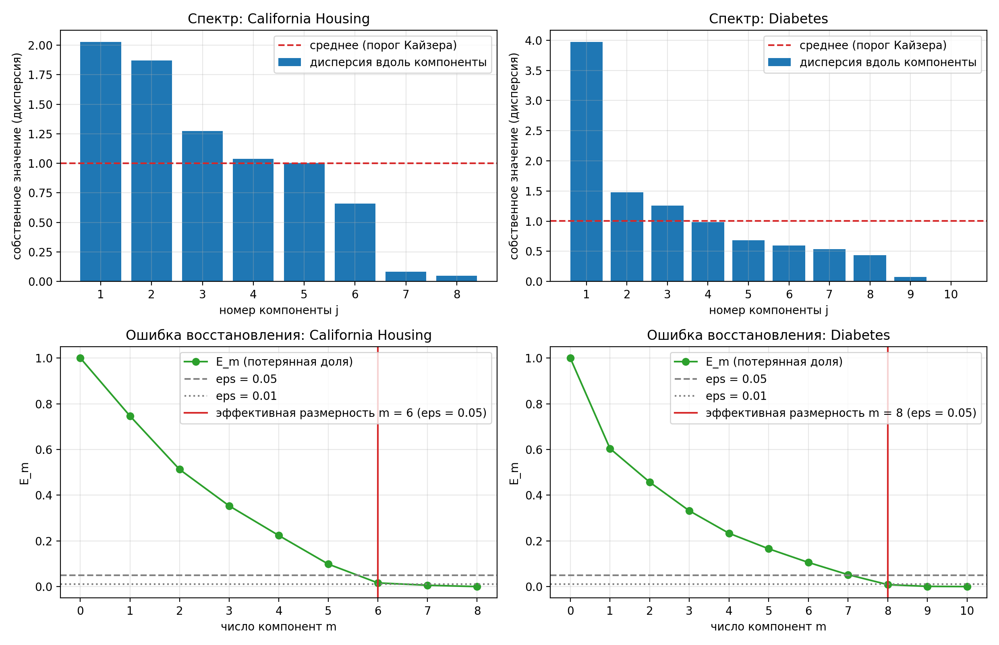

# Лабораторная работа №4. PCA

Студент: Шошников С.В.

Реализован метод главных компонент (PCA) через сингулярное разложение, определена эффективная размерность выборки, показана эквивалентность с `sklearn.decomposition.PCA`.

## Запуск

```bash
cd source
python main.py
```

Датасеты загружаются из `sklearn.datasets` при запуске. Графики сохраняются в каталог `lab4`. Время работы около минуты. На Windows при ошибке кодировки консоли запускать с `PYTHONIOENCODING=utf-8`.

Файлы: `source/pca.py` (собственная PCA и критерии размерности), `source/plots.py` (графики), `source/main.py` (эксперименты).

## Датасеты

Разбиение 70 / 30 (`random_state = 42`). Среднее и стандартное отклонение признаков считаются только по train и применяются к тесту.

| Датасет | Объектов (train / test) | Признаков | Ответ y |
|---|---|---|---|
| California Housing | 14448 / 6192 | 8 | медианная стоимость жилья в районе |
| Diabetes | 309 / 133 | 10 | прогрессирование болезни через год |

Признаки коррелированы: в California Latitude и Longitude -0.923, AveRooms и AveBedrms +0.846; в Diabetes s1 и s2 +0.891.



## Теоретическая основа

Обозначения: `X` матрица данных размера `l x n` (`l` объектов, `n` признаков), `y` вектор ответов длины `l`, `w` вектор весов длины `n`.

**Линейная регрессия и МНК.** Задача регрессии отличается от классификации тем, что ответ `y` вещественный. Модель `a(x) = <x, w>`. Метод наименьших квадратов (МНК) минимизирует остаточную сумму квадратов (RSS, residual sum of squares):

```text
RSS(w) = ||X w - y||^2 = sum_i (<x_i, w> - y_i)^2 -> min.
```

Приравнивая градиент к нулю, получаем нормальную систему `X^T X w = X^T y`, откуда `w = (X^T X)^{-1} X^T y`.

**Когда это не работает.** Запись с `(X^T X)^{-1}` требует невырожденной `X^T X`. Если признаки линейно зависимы или почти зависимы (мультиколлинеарность), матрица вырождена или плохо обусловлена, и коэффициенты становятся неустойчивыми: малое изменение данных сильно меняет `w`.

**Сингулярное разложение (SVD).** Любую матрицу данных можно записать как

```text
X = U Sigma V^T,
```

где:

- `U` (`l x l`) левые сингулярные векторы, столбцы `u_j` ортонормированы (`U^T U = I`), они описывают оси в пространстве объектов;
- `Sigma` (`l x n`) диагональная матрица, на диагонали сингулярные числа `sigma_1 >= sigma_2 >= ... >= 0`;
- `V` (`n x n`) правые сингулярные векторы, столбцы `v_j` ортонормированы (`V^T V = I`), они описывают оси в пространстве признаков. Именно они являются главными компонентами.

Связь с собственными числами: `X^T X = V Sigma^T Sigma V^T`, то есть `v_j` собственные векторы `X^T X`, а собственные значения равны `lambda_j = sigma_j^2`.

Подставляя разложение в МНК, получаем решение без обращения `X^T X`:

```text
w = V Sigma^{-1} U^T y = sum_j (1 / sigma_j) * v_j * (u_j^T y).
```

Смысл слагаемых: `u_j^T y` число, показывающее, сколько сигнала ответа `y` лежит в `j`-м направлении; `1 / sigma_j` деление на силу направления; `v_j` сам вектор направления в пространстве признаков, на который переносится вклад. Если `sigma_j` мала, множитель `1 / sigma_j` огромен, и слагаемое раздувает `w`: это влияние плохой обусловленности. Нулевые `sigma_j` (точная зависимость признаков) отбрасываются (псевдообратная матрица).

Гребневая регрессия (L2-регуляризация, штраф `tau ||w||^2`) заменяет множитель `1 / sigma_j` на `sigma_j / (sigma_j^2 + tau)`, то есть подавляет вклад слабых направлений. Именно это связывает SVD с PCA.

**Метод главных компонент (PCA)** это обучение без учителя: ответ `y` не используется. Нужно заменить `n` признаков на `m < n` новых так, чтобы по ним можно было как можно точнее восстановить исходные. Ищется ортонормированный набор осей `V_m` (первые `m` столбцов `V`, `n x m`, `V_m^T V_m = I`), минимизирующий ошибку восстановления.

**Сжатие и восстановление.** Для центрированной матрицы `X`:

```text
G     = X V_m          новые признаки (координаты объектов на осях), размер l x m,
X_hat = G V_m^T        восстановление (inverse_transform),
X_hat = X V_m V_m^T.
```

Поскольку `V_m^T V_m = I`, обратной операцией к проекции на оси является транспонирование: `V_m V_m^T` матрица-проектор на подпространство первых `m` главных компонент. Ошибка восстановления: `||X - X_hat||^2 = ||X - X V_m V_m^T||^2 -> min`.

**PCA через SVD.** Если оставить все компоненты (`V_m = V`), то `G = X V = U Sigma V^T V = U Sigma`, и `G V^T = U Sigma V^T = X`: полное восстановление точное. Столбцы `G` некоррелированы, дисперсия вдоль `j`-й оси равна `sigma_j^2 / (l - 1)`. Оптимальное приближение ранга `m` даёт усечённое разложение (теорема Эккарта-Янга), и ошибка восстановления равна сумме отброшенных `sigma_j^2`:

```text
||X - X_hat||^2 = sum_{j > m} sigma_j^2,
E_m = (sigma_{m+1}^2 + ... + sigma_n^2) / (sigma_1^2 + ... + sigma_n^2).
```

**Эффективная размерность** выборки наименьшее `m`, при котором `E_m <= eps`. Дополнительно используются эвристики: крутой склон (первое `m`, на котором `E_{m-1} / E_m >= 3`) и критерий Кайзера (число компонент с дисперсией выше средней). Критерии могут давать разные ответы.

**Центрирование и масштабирование.** Центрирование нужно, чтобы первая ось описывала разброс, а не положение облака. Стандартизация нужна, когда признаки в разных единицах: иначе компонента с самой большой дисперсией подавит остальные. Среднее и масштаб считаются по train и применяются к test, иначе информация из теста попадает в обучение.

**Знак компонент.** Векторы `v` и `-v` задают одну и ту же ось, поэтому знаки компонент у двух корректных реализаций могут различаться. При сравнении с эталоном знаки выравниваются.

## Реализация

`PCASVD` (`source/pca.py`): центрирует `X`, вызывает `numpy.linalg.svd(X, full_matrices=False)`, который возвращает `U`, `s`, `Vt` в той же нотации `X = U diag(s) V^T`: строки `Vt` это главные оси (столбцы `V`). Хранит среднее, оси, сингулярные числа, `explained_variance_ = s^2 / (l - 1)` и доли дисперсии; методы `transform` (`G = X V_m`), `inverse_transform` (`G V_m^T`), `residual_share` (`E_m`); функции `effective_dimension`, `steep_slope`, `kaiser`. Эталон: `sklearn.decomposition.PCA`.

Примечание: в некоторых конспектах разложение записывают как `F = V D U^T`, где роли `U` и `V` поменяны местами (`U` оси признаков, `V` координаты объектов, `D` диагональная матрица). Здесь везде используется классическая запись `X = U Sigma V^T`: `V` оси признаков, `U` оси объектов.

## Результаты

### Эквивалентность с `sklearn.decomposition.PCA`

Максимальное расхождение `PCA(svd_solver="full")` и собственной реализации:

| Что сравниваем | California | Diabetes |
|---|---:|---:|
| `mean_`, `singular_values_`, `explained_variance_` | 0 | 0 |
| `explained_variance_ratio_` | 2.8e-17 | 2.8e-17 |
| `components_` после выравнивания знаков | 0 | 0 |
| `transform` на тесте | 7.1e-15 | 8.9e-16 |
| `inverse_transform` | не более 4.0e-15 | не более 8.9e-16 |

До выравнивания знак компонент отличался у 4 из 8 (California) и 2 из 10 (Diabetes): вектор `v` и `-v` задают одну ось, поэтому это не ошибка.

Проверены также свойства разложения: оси ортонормированы (расхождение порядка 1e-15), проекции некоррелированы, дисперсия проекций равна `s^2/(n-1)`, полное восстановление возвращает исходные данные, ошибка усечённого восстановления равна `E_m` (California, `k = 4`: 0.223741 обоими способами).

### Эффективная размерность

California Housing:

| m | 1 | 2 | 3 | 4 | 5 | 6 | 7 | 8 |
|---|---|---|---|---|---|---|---|---|
| E_m | 0.747 | 0.513 | 0.353 | 0.224 | 0.098 | 0.016 | 0.006 | 0.000 |

Diabetes:

| m | 1 | 2 | 3 | 4 | 5 | 6 | 7 | 8 | 9 | 10 |
|---|---|---|---|---|---|---|---|---|---|---|
| E_m | 0.604 | 0.457 | 0.332 | 0.233 | 0.165 | 0.106 | 0.052 | 0.009 | 0.001 | 0.000 |

| Критерий | California | Diabetes |
|---|---:|---:|
| `E_m <= 0.05` | 6 | 8 |
| `E_m <= 0.01` | 7 | 8 |
| крутой склон | 6 | 8 |
| Кайзер | 5 | 3 |



Эффективная размерность California равна 6 из 8, Diabetes 8 из 10: последние компоненты порождены сильной корреляцией пар признаков. Критерий Кайзера отвечает на другой вопрос (какие оси выше среднего уровня), поэтому даёт меньшие числа: критерии не обязаны совпадать.


На California PCA чувствителен к выбросам: в необрезанной проекции облако сжато из-за нескольких районов с аномальными значениями, поэтому на графике оси обрезаны по 0.5-99.5 перцентилям.

### Линейно зависимые признаки (синтетика)

7 признаков: три скрытых фактора, шум 0.05, последний признак равен сумме двух других. Эффективная размерность равна 3 (`E_3 = 0.015`). Без шума ранг матрицы равен 3, четыре сингулярных числа обращаются в ноль, но PCA через SVD работает без проблем.

## Выводы

1. PCA реализована через SVD центрированной матрицы и совпадает с `sklearn.decomposition.PCA` до машинной точности (после выравнивания знаков компонент).
2. Эффективная размерность по критерию `E_m <= 0.05`: 6 из 8 (California) и 8 из 10 (Diabetes); лишние компоненты порождены корреляцией признаков. Критерии размерности эвристические и могут расходиться.
3. PCA работает и при линейно зависимых признаках: нулевые сингулярные числа соответствуют нулевой дисперсии.
